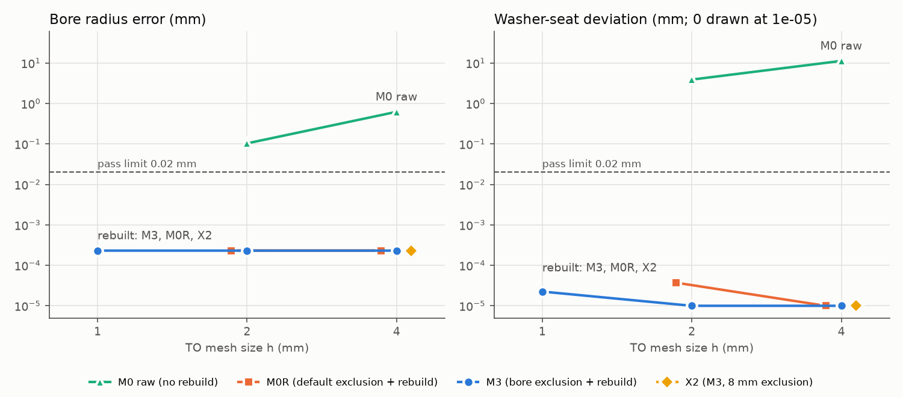
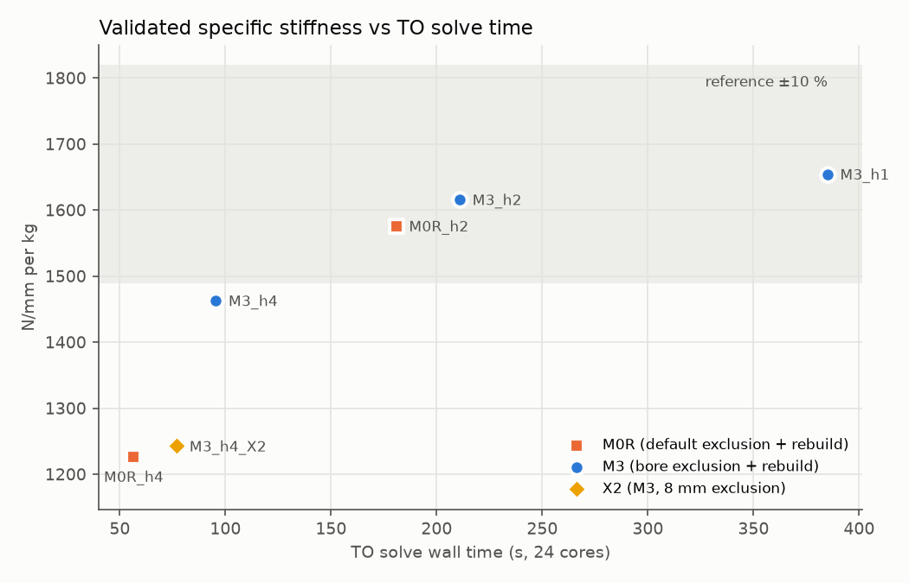

# Exclude-and-rebuild topology optimization: results

**Date:** 2026-10-16. **Runs:** M3 at h = 4, 2, 1 (reference); M0 and M0R at h = 4, 2; extra X2 at h = 4.
**Tools:** Ansys 2026 R1 Mechanical (level-set TO), rebuild in `manifold3d`, validation meshed in Ansys Prime and solved in MAPDL.
**Data:** [`summary.csv`](summary.csv) (one row per run, every metric). Phase 3 details are in [`smoke_test.md`](smoke_test.md).

## Bottom line

- **Rebuilding preserves the small features exactly, at every mesh size.** Every rebuilt part (M3, M0R, X2, at h = 4, 2, 1) has bore radius error ≤ 0.0002 mm and washer-seat deviation ≤ 0.00004 mm, with no eroded seats, FIX and LOAD in one body, and both PASSIVE bores attached. The pass limit is 0.02 mm, so these are 100× inside it.
- **Without the rebuild, features are lost even at h = 2.** Raw M0 bores are off by 0.32–0.62 mm at h = 4 and about 0.1 mm at h = 2. Its seats deviate by 11.3 mm (92 eroded samples) and 3.9 mm.
- **The rebuild is what delivers fidelity; the exclusion choice is what delivers performance.** M0R gets the same exact features as M3. But M3's bore-face exclusion (3.75 mm) gives a stiffer part at coarse meshes: +19 % specific stiffness over M0R at h = 4 and +2.5 % at h = 2.
- **Recommendation:** use M3 + rebuild at **h = 2**. Its features are exact, its specific stiffness is within 2.3 % of the h = 1 reference, and the TO solve takes half the time. The rebuild adds seconds.

## 1. Feature preservation (primary objective)

| Run | bore radius error, max (mm) | seat deviation, max (mm) | seat misses | FIX–LOAD | PASSIVE attached | max seam dip |
|---|---|---|---|---|---|---|
| M3_h1 | 0.0002 | 0.00002 | 0 | connected | 2/2 | 13.5 % |
| M3_h2 | 0.0002 | 0 | 0 | connected | 2/2 | 18.2 % |
| M3_h4 | 0.0002 | 0 | 0 | connected | 2/2 | 22.6 % |
| M0R_h2 | 0.0002 | 0.00004 | 0 | connected | 2/2 | 12.0 % |
| M0R_h4 | 0.0002 | 0 | 0 | connected | 2/2 | 16.4 % |
| M3_h4_X2 | 0.0002 | 0 | 0 | connected | 2/2 | 0.0 % |
| M0_h2 (raw) | 0.10 | 3.9 | 0 | connected | 2/2 | 11.8 % |
| M0_h4 (raw) | 0.62 | 11.3 | 92 | connected | 2/2 | 0.0 % |

- **Bores:** after the rebuild, the residual 0.0002 mm is the STL faceting of the keep cylinders (180 segments), not the TO. Raw M0's FIX and LOAD bores are 0.32–0.33 mm oversize at h = 4, and 0.10 mm at h = 2. The unmarked PASSIVE bores are worse, with up to 1.5 mm radial deviation at both sizes.
- **Seats:** the rebuild restores the Ø9 washer annuli on both faces of every bore. Raw M0 erodes them.
- **Connectivity and seams:** no run is disconnected, and no seam neck exceeds the 25 % flag. The largest dip, 22.6 % for M3_h4, shrinks as h decreases. X2's 8 mm exclusion leaves no neck at all.
- **What the rebuild changes:** it adds 1 400–2 300 mm³ (`∪ keep`, about 2 % of the part) and always trims exactly 1 908 mm³ (`∩ space`). That is the volume of the 8 bores, so the TO fills every bore at every h and the rebuild reopens them. See [`volume_bookkeeping.png`](volume_bookkeeping.png).

## 2. Stiffness and cost (secondary)

| Run | TO elements | iterations | TO time (s, 24 cores) | final volume | specific stiffness (N/mm/kg) | vs reference | model-form gap |
|---|---|---|---|---|---|---|---|
| M3_h1 (reference) | 428 171 | 18 | 385 | 59.7 % | 1 654 | – | +0.4 % |
| M3_h2 | 80 242 | 18 | 211 | 59.6 % | 1 616 | −2.3 % | +1.3 % |
| M3_h4 | 16 860 | 9 | 95 | 59.1 % | 1 463 | −11.6 % | +9.9 % |
| M0R_h2 | 80 242 | 14 | 181 | 59.5 % | 1 576 | −4.7 % | +2.2 % |
| M0R_h4 | 16 860 | 3 | 57 | 56.9 % | 1 227 | −25.9 % | +13.0 % |
| M3_h4_X2 | 16 860 | 3 | 77 | 58.3 % | 1 243 | −24.9 % | +13.5 % |

- **Validation:** every rebuilt part converges, with pilot UZ changing less than 0.3 % between the two mesh levels. A full-body check matches Mechanical's model to 0.42 % (Phase 3), so the validation BCs are equivalent.
- **Model-form gap:** this is the validated strain energy over the optimizer's own final value. It falls from +9.9 % at h = 4 to +0.4 % at h = 1. A coarse TO model overrates its own stiffness, but the rebuilt part is what gets validated.
- **Cost:** h = 2 halves the TO time relative to h = 1. h = 4 saves 4× but loses 11.6 % specific stiffness, just outside the 10 % criterion. At h = 4, wall time is mostly fixed overhead: on 4 cores instead of 24, the same M3_h4 solve took 44 s, with the same result to 0.14 %.
- **Early stops:** the optimizer ends below the 60 % volume target (57–59.7 %), and the 3-iteration runs (M0 at h = 4, X2) stop furthest short and are the least stiff. Comparisons are per unit mass, which absorbs this (accepted at Gate 2).
- **Stresses** are indicative only (Gate 2) and aren't reported here; peak values are in `summary.csv`.

## 3. Pass/fail against the criteria (plan Section 9)

| Criterion | Limit | Result |
|---|---|---|
| Bore fidelity (rebuilt runs) | ≤ 0.02 mm at every h | **Pass**: 0.0002 mm for all 6 rebuilt runs |
| Seat flatness (rebuilt runs) | ≤ 0.02 mm, no misses | **Pass**: ≤ 0.00004 mm, 0 misses |
| Load-path connectivity | required | **Pass**: all 8 runs |
| PASSIVE attachment | recorded | attached in all 8 runs |
| Seam necks | flag dips > 25 % | no flags (max 22.6 %) |
| Specific stiffness, coarse and medium M3 vs h = 1 | within 10 % | **Pass** at h = 2 (−2.3 %); **fail** at h = 4 (−11.6 %) |

## 4. Predictions vs outcomes (plan Section 10)

| Prediction | Outcome |
|---|---|
| M0: bosses reasonably sized, bores faceted at h = 4, PASSIVE survives as chord material with mangled bores | **Held.** Bores are 0.3 mm oversize, and PASSIVE bores deviate by up to 1.5 mm. Seats are also badly eroded (11.3 mm, 92 misses), which wasn't predicted. |
| M0R: exact wherever material reaches, PASSIVE attached | **Held.** |
| M3: exact at every h, everything attached | **Held**, at h = 4, 2 and 1. |
| Payoff: coarse M3 within 10 % of the reference, with a large time saving | **Partly.** h = 2 is within 2.3 % at half the time. h = 4 misses by 1.6 points, and its time saving is limited by fixed overhead. |
| X2: 8 mm fixes under-held bosses at h = 4 | **Not needed, and it hurts.** M3's 3.75 mm bosses weren't under-held: the rebuild only had to restore a 0–11 % annulus shortfall. The 8 mm exclusion freezes more material, stops after 3 iterations, and costs 15 % specific stiffness. |

## 5. Recommendation for production use

1. **Always rebuild:** `(opt ∪ keep) ∩ space` after the TO. It is the only thing that makes bores and seats exact, it costs seconds, and it is robust: no repair was needed on any level-set export.
2. **Exclude with M3:** a named selection of the bore faces, with Exclusion Thickness set manually to (keep − bore)/2. Don't use Ansys's 2h default (X2) or all-BC exclusion (M0). Larger frozen regions cut the optimization short and cost stiffness.
3. **Optimize at h = 2.** It's within 2.3 % of the h = 1 stiffness at half the TO time. Use h = 4 only for quick concept checks; features stay exact there, but stiffness drops 12 %.
4. **Validate the rebuilt part, not the optimizer's number.** At h = 4 the optimizer overstates stiffness by about 10 %. The validation chain here (Prime wrap → quadratic tets → MAPDL) takes about 7–8 min per part on 24 cores.

## Scope and caveats

- One part, one load case, and level-set TO only. M2/X3 (element-based exclusion), X1, X4 and X5 weren't run, and neither was M0 at h = 1.
- Timings are wall times on one 24-core workstation using two HPC packs from the shared pool. At h = 4 they are mostly overhead.
- Validation meshes the Prime wrap of each part, not the STL itself. The wrap is within 4e-4 in volume, and bore nodes are within 0.034 mm of nominal (Phase 3).
- Stress results are indicative only.
